# 📘 BiblioInfo — Guía Maestra de Especificaciones, Arquitectura y Video Explicativo

> **Componente Práctico Web | Evaluación de Desarrollo Full Stack (React + Node.js/Express + Persistencia JSON)**  
> **Temática Asignada:** Opción 6 — *Reseñas de libros*  
> **Equipo de Desarrollo (4 Integrantes):** Danilo, Darly, Francisco y Gabriel  
> **Stack:** React 19 (Vite + Vanilla CSS & Tailwind) $\rightarrow$ API REST Express (Node.js) $\rightarrow$ Persistencia atómica en `reviews.json` $\rightarrow$ Integración externa con Google Books API  
> **Calificación Total:** 30 Puntos (20 pts Video Grupal de Desarrollo + 10 pts Pregunta Técnica Individual)

---

## 📑 Tabla de Contenidos
1. [Matriz de Cumplimiento de la Rúbrica Oficial (100% Verificado)](#1-matriz-de-cumplimiento-de-la-rúbrica-oficial-100-verificado)
2. [Arquitectura del Sistema y Flujo de Datos de Extremo a Extremo](#2-arquitectura-del-sistema-y-flujo-de-datos-de-extremo-a-extremo)
3. [Características Destacadas y Valor Agregado del Proyecto](#3-características-destacadas-y-valor-agregado-del-proyecto)
4. [Estructura del Proyecto y Archivos Clave](#4-estructura-del-proyecto-y-archivos-clave)
5. [Guion Minuto a Minuto para el Video Grupal (20 a 30 Minutos - 20 Puntos)](#5-guion-minuto-a-minuto-para-el-video-grupal-20-a-30-minutos---20-puntos)
6. [Banco de Preguntas Técnicas Individuales para Clase (10 Puntos)](#6-banco-de-preguntas-técnicas-individuales-para-clase-10-puntos)
7. [Protocolo de Pruebas en Vivo para la Grabación y Exposición](#7-protocolo-de-pruebas-en-vivo-para-la-grabación-y-exposición)
8. [Estructura del Informe PDF de Entrega](#8-estructura-del-informe-pdf-de-entrega)

---

## 1. Matriz de Cumplimiento de la Rúbrica Oficial (100% Verificado)

| Requisito de la Rúbrica | Estado | Implementación en BiblioInfo | Archivos Clave |
| :--- | :---: | :--- | :--- |
| **Temática Exclusiva: Opción 6 (Reseñas de libros)** |  Cumple | Modelo de datos completo: libro, autor de la obra, autor de la reseña, email, género, fecha, calificación (1-5★) y descripción. | `backend/data/reviews.json`, `validator.js` |
| **SPA en React con mínimo 3 rutas** |  Cumple | `/` (Bienvenida y navegación), `/registro` (Formulario), `/lista` (Catálogo con filtros) y ruta adicional `/libro/:id` (Ficha del libro). | `frontend/src/App.jsx` |
| **Componentes Reutilizables y Limpieza** |  Cumple | `Navbar`, `Footer`, `ReviewForm`, `ReviewCard`, `BookCover`, `Spinner`, `AlertMessage`, modales. | `frontend/src/components/*` |
| **Formulario controlado con `useState`** |  Cumple | Estado reactivo con validación instantánea por campo, contador de caracteres y bloqueo del submit si hay errores. | `frontend/src/components/ReviewForm.jsx` |
| **Validaciones en Cliente** |  Cumple | Campos obligatorios, regex de email válido, fechas existentes (sin fechas futuras), longitud mínima de reseña. | `ReviewForm.jsx` |
| **Consumo de API con Fetch (`GET` y `POST`)** |  Cumple | Servicio centralizado `api.js` que maneja `getReviews(genero)` y `createReview(reviewData)` con respuestas JSON. | `frontend/src/services/api.js` |
| **Manejo de Estados en Frontend** |  Cumple | Estados de carga (`Spinner`), lista vacía (`Empty State`), confirmación exitosa (`AlertMessage`) y error de conexión. | `ReviewList.jsx`, `Register.jsx` |
| **Actualización tras registrar** |  Cumple | Al publicar reseña, redirige a `/lista` y refresca el catálogo en vivo con la nueva tarjeta al inicio. | `Register.jsx`, `ReviewList.jsx` |
| **Interfaz adaptable (Responsive)** |  Cumple | Diseño optimizado para móviles, tablets y monitores grandes con paleta de colores literaria y modo oscuro. | `index.css`, Tailwind |
| **API REST en Express** |  Cumple | `GET /registros` (con filtro opcional `?genero=`) y `POST /registros` que responde 200, 201 y 400. | `backend/src/routes/reviewsRoutes.js` |
| **Validación estricta en Servidor** |  Cumple | Validador rechaza fechas falsas (ej. 30 de febrero), enteros de calificación fuera de 1-5 y correos mal formados. | `backend/src/utils/validator.js` |
| **ID único por registro** |  Cumple | Generación de identificadores universales mediante `crypto.randomUUID()`. | `backend/src/utils/fileHandler.js` |
| **Gestión de errores y CORS** |  Cumple | Middleware `cors()` configurado para orígenes cruzados (puerto 5173 hacia 5000) y manejo de errores sin colapsar el servidor. | `backend/src/server.js` |
| **Persistencia en archivo JSON** |  Cumple | Persistencia atómica con cola de escrituras asíncronas en `reviews.json`. Si no existe, se inicializa como `[]`. | `backend/src/utils/fileHandler.js` |
| **Prueba de reinicio del backend** |  Cumple | Al apagar el servidor con `Ctrl+C` y reiniciarlo, los datos se mantienen íntegros en el disco. | Verificado con 28 reseñas persistidas |
| **Repositorio Git ordenado** |  Cumple | Carpetas separadas `frontend/` y `backend/`, `.gitignore` sin `node_modules`, `README.md` completo y commits de los 4 integrantes. | Repositorio GitHub en rama `dev` y `main` |

---

## 2. Arquitectura del Sistema y Flujo de Datos de Extremo a Extremo

El flujo de información de BiblioInfo sigue una arquitectura unidireccional y robusta:

```
┌─────────────────────────────────────────────────────────────────────────────────┐
│                                 FRONTEND (REACT)                                │
│                                                                                 │
│  [Usuario] ──(Escribe título)──► [ReviewForm] ◄──(Sugerencias)──► [Google Books]│
│       │                                │                                        │
│       ▼                                ▼                                        │
│  (Click Submit) ──────────────► [api.js: createReview]                          │
└───────────────────────────────────────┬─────────────────────────────────────────┘
                                        │ HTTP POST /registros (JSON)
                                        ▼
┌─────────────────────────────────────────────────────────────────────────────────┐
│                            BACKEND (EXPRESS / NODE.JS)                          │
│                                                                                 │
│  [server.js (CORS / express.json)] ──► [reviewsRoutes.js]                       │
│                                                │                                │
│                                                ▼                                │
│                                    [reviewsController.js]                       │
│                                                │                                │
│                       ┌────────────────────────┴────────────────────────┐       │
│                       ▼                                                 ▼       │
│              [validator.js (400)]                           [fileHandler.js]    │
│            (Rechaza datos erróneos)                     - Genera UUID v4        │
│                                                         - Cola de escritura     │
│                                                         - Sincroniza portadas   │
│                                                                 │               │
│                                                                 ▼               │
│                                                     [data/reviews.json]         │
└─────────────────────────────────────────────────────────────────┬───────────────┘
                                                                  │
                                 HTTP GET /registros              │
                                ◄─────────────────────────────────┘
                                │
┌───────────────────────────────▼─────────────────────────────────────────────────┐
│                           CATÁLOGO Y VISUALIZACIÓN                              │
│                                                                                 │
│  [ReviewList.jsx (useEffect)] ──► Filtra por pastillas de género o búsqueda     │
│       │                                                                         │
│       ├──► [ReviewCard.jsx] ──► [BookCover.jsx: Renderizado 3D de lomo y foto]  │
│       └──► [BookDetail.jsx] ──► Ficha técnica del libro y opiniones             │
└─────────────────────────────────────────────────────────────────────────────────┘
```

---

## 3. Características Destacadas y Valor Agregado del Proyecto

### 3.1. Autocompletado Inteligente con Google Books API y Libros Locales
* **Búsqueda en tiempo real:** Al escribir 2 o más letras en el campo *Título del Libro*, un hook con `debounce` consulta la API oficial de Google Books:
  ```javascript
  `https://www.googleapis.com/books/v1/volumes?q=${encodeURIComponent(query)}&maxResults=6`
  ```
* **Fallback a Open Library:** Si Google Books no responde o tiene límites de cuota, el sistema consulta automáticamente la API abierta de Open Library.
* **Sugerencia de libros locales de la web:** El autocompletado también busca en el catálogo interno de Biblioinfo. Si un libro ya fue registrado en la plataforma (incluso si no tiene portada o no está en Google), aparece con una etiqueta distintiva `"En la web"`.
* **Relleno automático:** Al seleccionar un libro sugerido, se completan de inmediato el título, el autor, el género literario y la URL segura (`https://`) de la portada oficial.

### 3.2. Renderizado Hiperrealista de Libros 3D (`BookCover.jsx`)
* **Diseño volumétrico:** Cada libro se dibuja como un volumen físico con perspectiva 3D, lomo con pliegue de encuadernación, textura de papel prensado, gradiente de iluminación cenital y sombra proyectada.
* **Soporte de portadas reales:** Si el libro tiene foto de portada (obtenida de la API o ingresada), se proyecta sobre la textura 3D respetando la curvatura del lomo y las proporciones editoriales estándar.
* **Sincronización automática de portadas:** Si un usuario publica una reseña con una foto de portada para un libro preexistente, el backend actualiza automáticamente todas las reseñas anteriores de ese mismo libro para que todas compartan la misma portada oficial.

### 3.3. Sistema de Filtros Conectados con Pastillas (Pills)
* El usuario puede filtrar reseñas por género mediante pastillas clicables interactivas en `/lista`.
* **Conexión con Inicio:** Al hacer clic en cualquiera de los géneros en la página de Inicio (`/`), el usuario es redirigido a `/lista?genero=Nombre` con la pastilla activada y los libros filtrados al instante.

### 3.4. Persistencia Atómica con Cola Concurrente (`fileHandler.js`)
* Para evitar que múltiples escrituras simultáneas corrompan el archivo `reviews.json`, se diseñó una cola asíncrona (`writeQueue`) que procesa las escrituras de forma secuencial garantizando integridad transaccional.

---

## 4. Estructura del Proyecto y Archivos Clave

```
Biblioinfo/
├── README.md                          # Rúbrica oficial, equipo y comandos de ejecución
├── GUIA_MAESTRA_BIBLIOINFO.md         # Guía de arquitectura, video grupal y preguntas
│
├── backend/                           # API REST en Node.js y Express (Puerto 5000)
│   ├── package.json
│   ├── data/
│   │   └── reviews.json               # Archivo JSON con las 28 reseñas persistidas
│   └── src/
│       ├── server.js                  # Inicialización de Express, CORS y middlewares
│       ├── routes/
│       │   └── reviewsRoutes.js       # Definición de rutas GET y POST /registros
│       ├── controllers/
│       │   └── reviewsController.js   # Lógica de controladores y respuestas HTTP
│       └── utils/
│           ├── fileHandler.js         # Lectura/escritura atómica y sincronización
│           └── validator.js           # Validación rigurosa de fechas y campos
│
└── frontend/                          # SPA en React 19 + Vite (Puerto 5173)
    ├── package.json
    ├── vite.config.js
    └── src/
        ├── App.jsx                    # Enrutador SPA con BrowserRouter
        ├── index.css                  # Estilos globales, paleta literaria y temas
        ├── services/
        │   ├── api.js                 # Cliente HTTP con Fetch a http://localhost:5000
        │   └── bookSearch.js          # Integración con Google Books y Open Library
        ├── components/
        │   ├── Navbar.jsx             # Barra de navegación con logo y enlaces
        │   ├── Footer.jsx             # Pie de página institucional
        │   ├── ReviewForm.jsx         # Formulario reactivo con autocompletado
        │   ├── ReviewCard.jsx         # Tarjeta con modal de lectura completa
        │   ├── BookCover.jsx          # Componente 3D para render de libros
        │   ├── Spinner.jsx            # Indicador visual de carga animado
        │   └── AlertMessage.jsx       # Alertas de error y confirmación
        └── pages/
            ├── Home.jsx               # Bienvenida, métricas y géneros destacados
            ├── Register.jsx           # Vista de publicación de reseñas
            ├── ReviewList.jsx         # Catálogo con buscador y pastillas de filtro
            └── BookDetail.jsx         # Ficha técnica del libro y opiniones
```

---

## 5. Guion Minuto a Minuto para el Video Grupal (20 a 30 Minutos - 20 Puntos)

> **Requisito obligatorio:** Los 4 integrantes deben aparecer en cámara (rostro visible o intervención activa por voz) y aportar una explicación técnica sustantiva del código que construyeron.

```mermaid
gantt
    title Cronograma de la Grabación del Video Grupal (25 min aprox.)
    dateFormat  mm
    axisFormat  %M min
    Etapa 1 - Presentación y Exclusividad (Gabriel y Equipo) :00, 3m
    Etapa 2 - Preparación y Entornos (Gabriel)               :03, 3m
    Etapa 3 - Construcción Frontend y Formulario (Darly)     :06, 5m
    Etapa 4 - Construcción Backend y Persistencia (Danilo)   :11, 5m
    Etapa 5 - Integración HTTP y Catálogo (Francisco)        :16, 4m
    Etapa 6 - Demostración en Vivo y Pruebas (Todos)         :20, 5m
    Etapa 7 - Cierre, Retos y Repositorio (Todos)            :25, 3m
```



---

### 🎬 Etapa 1: Presentación (00:00 - 03:00) — *Conduce Gabriel con el equipo*
* **Qué mostrar en pantalla:** Diapositiva o portada del informe con el título del proyecto y los 4 integrantes. Luego compartir la pantalla con la **hoja colaborativa de registro de temas del curso**.
* **Intervención del equipo:**
  * **Gabriel:** *"Saludos profesor y compañeros. Somos el Grupo de Desarrollo de la Opción 6: Reseñas de Libros. Nuestro proyecto se llama BiblioInfo. Mi nombre es Gabriel Asunción y me desempeñé como responsable de UI, QA y Documentación. Me acompañan Danilo (Backend Lead), Darly (Frontend & Validaciones) y Francisco (Frontend Lead & Integración)."*
  * **Darly:** *"Nuestra aplicación resuelve la necesidad de una comunidad lectora para publicar y descubrir reseñas literarias de forma ágil, con persistencia garantizada en el servidor."*
  * **Danilo:** *"Como se observa en el registro compartido del curso, nuestro equipo reservó con exclusividad la Opción 6, asegurando que ningún otro grupo replique esta temática."*
  * **Francisco:** *"A continuación, mostramos la arquitectura técnica y la distribución del trabajo realizada por cada integrante."*

---

### 💻 Etapa 2: Preparación del Entorno (03:00 - 06:00) — *Expone Gabriel*
* **Qué mostrar en pantalla:** El editor de código VS Code con el árbol de directorios abierto, los archivos `package.json` de frontend y backend, y dos terminales.
* **Intervención de Gabriel:**
  * *"La arquitectura de BiblioInfo se organizó en dos carpetas totalmente desacopladas: `backend/` para la API REST en Node.js y Express, y `frontend/` para la SPA en React construida con Vite."*
  * *"Revisamos el archivo `.gitignore` para evidenciar que las carpetas `node_modules` no se suben al repositorio, cumpliendo con las buenas prácticas de Git."*
  * *"Abrimos la Terminal 1 en la carpeta backend y ejecutamos `npm run dev`. Vemos que el servidor Express levanta exitosamente en el puerto 5000."*
  * *"En la Terminal 2, dentro de la carpeta frontend, ejecutamos `npm run dev` e iniciamos el servidor de Vite en `http://localhost:5173`. Ambas partes están listas para comunicarse."*

---

### 📝 Etapa 3: Construcción del Frontend y Formulario (06:00 - 11:00) — *Expone Darly*
* **Qué mostrar en pantalla:** El código de `ReviewForm.jsx`, `bookSearch.js` y `BookCover.jsx`, abriendo la vista `/registro` en el navegador.
* **Intervención de Darly:**
  * *"En el frontend, implementé el formulario controlado en `ReviewForm.jsx` utilizando el hook `useState` para gestionar reactivamente cada uno de los campos requeridos: libro, autor de la obra, nombre del reseñador, email, género, calificación del 1 al 5 y la descripción."*
  * *"Incorporamos un valor agregado muy potente: **autocompletado en tiempo real con Google Books API** a través del servicio `bookSearch.js`. Al escribir el título del libro, un hook con debounce consulta los volúmenes de Google Books y también nuestro catálogo local en `reviews.json`. Al seleccionar una sugerencia, se autocompleta el autor, el género y la foto de portada oficial en alta definición."*
  * *"Diseñamos validaciones estrictas en el cliente: regex para correos electrónicos válidos, bloqueo absoluto de fechas futuras y longitud mínima de reseña. Si el usuario intenta enviar datos erróneos, la interfaz no emite la petición y muestra alertas visuales comprensibles en color rojo."*

---

### ⚙️ Etapa 4: Construcción del Backend y Persistencia (11:00 - 16:00) — *Expone Danilo*
* **Qué mostrar en pantalla:** El código de `server.js`, `reviewsRoutes.js`, `reviewsController.js`, `validator.js` y `fileHandler.js`.
* **Intervención de Danilo:**
  * *"En el backend, configuramos Express con los middlewares `cors()` para habilitar las peticiones cruzadas desde el puerto 5173 de React hacia el puerto 5000, y `express.json()` para el procesamiento de cuerpos de petición en formato JSON."*
  * *"Definimos los endpoints REST: `GET /registros` para consultar las reseñas existentes (con soporte para el parámetro de consulta `?genero=`) y `POST /registros` para registrar una nueva reseña."*
  * *"En `validator.js` implementamos una capa de seguridad en el servidor que valida que los campos requeridos no estén vacíos, que la calificación sea un número entero del 1 al 5 y que la fecha exista realmente en el calendario (rechazando fechas falsas como el 30 de febrero). Si falla, respondemos con código HTTP 400 y una lista de errores."*
  * *"La persistencia se maneja en `fileHandler.js` con el módulo asíncrono nativo `fs/promises`. Cada reseña recibe un identificador universal único generado con `crypto.randomUUID()`. Para evitar condiciones de carrera si varios usuarios envían datos al mismo tiempo, creamos una cola de escritura atómica que asegura que el archivo `reviews.json` nunca se sobreescriba de manera corrupta."*

---

### 🌐 Etapa 5: Integración HTTP y Catálogo (16:00 - 20:00) — *Expone Francisco*
* **Qué mostrar en pantalla:** El código de `frontend/src/services/api.js`, `App.jsx` y `ReviewList.jsx`.
* **Intervención de Francisco:**
  * *"La comunicación entre React y Express se centralizó en el servicio `api.js`. Mediante la Fetch API nativa, la función `createReview()` envía una petición `POST` con cabeceras `Content-Type: application/json`, mientras que `getReviews()` realiza peticiones `GET` hacia `http://localhost:5000/registros`."*
  * *"En `ReviewList.jsx`, utilizamos el hook `useEffect` con un array de dependencias para consultar las reseñas una sola vez al montar el componente, evitando ciclos infinitos. Gestionamos cuatro estados visuales indispensables: estado de carga con el componente `Spinner.jsx`, estado de error si el servidor no responde, estado de lista vacía si aún no hay registros y la cuadrícula de tarjetas cuando los datos llegan exitosamente."*
  * *"Implementamos pastillas de filtro por género en tiempo real conectadas con el Inicio, un buscador por texto y el componente `BookCover.jsx` que renderiza cada libro con efecto 3D, lomo editorial y portada fotográfica. También añadimos la ruta `/libro/:id` para consultar la ficha completa de cada obra literaria."*

---

### 🧪 Etapa 6: Demostración en Vivo y Pruebas (20:00 - 25:00) — *Todo el equipo*
* **Qué mostrar en pantalla:** El navegador ejecutando la aplicación de extremo a extremo y una vista dividida con el archivo `reviews.json`.
* **Secuencia de Pruebas:**
  1. **Prueba de Autocompletado y Registro Válido (Darly):**
     * Ir a `/registro`, escribir *"Cien años de soledad"*.
     * Mostrar cómo se despliegan las sugerencias de Google Books y catálogo local.
     * Seleccionar la sugerencia: se autocompleta Gabriel García Márquez, género Ficción y la foto de portada.
     * Completar nombre (*"Estudiante UNEMI"*), fecha actual y calificación (5 estrellas).
     * Hacer clic en *"Publicar Reseña"* $\rightarrow$ Mensaje de éxito y redirección a `/lista`.
  2. **Comprobación en el Catálogo y Detalle (Francisco):**
     * Mostrar la reseña recién creada con su portada 3D al inicio de `/lista`.
     * Probar el filtro de la pastilla *"Ficción"* y el buscador.
     * Hacer clic en el libro para abrir su ficha dedicada en `/libro/:id`.
  3. **Prueba de Validaciones de Error (Gabriel):**
     * Volver a `/registro`, dejar campos vacíos e intentar enviar $\rightarrow$ Se marcan los inputs en rojo y se bloquea el envío.
     * Colocar un correo inválido (`test@`) o fecha futura $\rightarrow$ Se muestra la alerta correspondiente.
  4. **Prueba Crítica de Persistencia tras Reinicio (Danilo):**
     * Mostrar en VS Code el archivo `backend/data/reviews.json` con la nueva reseña registrada.
     * Ir a la Terminal 1 del backend y presionar `Ctrl + C` para **apagar completamente el servidor Node.js**.
     * Recargar el navegador en `/lista` $\rightarrow$ Muestra el banner de fallo de conexión (servidor apagado).
     * Reiniciar el servidor con `npm run dev`.
     * Recargar el navegador $\rightarrow$ **Todas las reseñas siguen intactas en pantalla porque están físicamente guardadas en el disco.**

---

### 🏁 Etapa 7: Cierre, Retos y Repositorio Git (25:00 - 28:00) — *Todo el equipo*
* **Qué mostrar en pantalla:** La página del repositorio en GitHub mostrando los commits de los 4 integrantes y el árbol de ramas.
* **Intervención del equipo:**
  * **Danilo:** *"El principal reto en el backend fue garantizar la atomicidad en la escritura del JSON para evitar pérdida de datos concurrentes, resuelto mediante la cola de promesas."*
  * **Darly:** *"En el frontend, el mayor desafío fue sincronizar el autocompletado asíncrono de Google Books con el estado de React sin generar re-renderizados innecesarios."*
  * **Francisco:** *"Logramos una integración limpia con Vite y React Router, asegurando que la navegación sea fluida y responsiva en cualquier dispositivo."*
  * **Gabriel:** *"Mostramos el historial de commits en GitHub con contribuciones identificables de Danilo, Darly, Francisco y Gabriel, cumpliendo al 100% con la rúbrica de evaluación. Muchas gracias por su atención."*

---

## 6. Banco de Preguntas Técnicas Individuales para Clase (10 Puntos)

El docente realizará una pregunta técnica individual a cada estudiante durante la defensa en clase. A continuación se presentan las preguntas más probables con sus respuestas exactas fundamentadas en el código:

---

### 👤 Para DANILO (Backend Lead & Persistencia JSON)

* **Pregunta 1:** *¿Cómo garantizaste la persistencia sin usar una base de datos relacional y cómo previenes que dos peticiones simultáneas corrompan el archivo `reviews.json`?*  
  **Respuesta:**  
  > *"Utilizamos el módulo nativo `fs/promises` de Node.js en `fileHandler.js`. Para evitar colisiones o corrupción por concurrencia, implementamos un patrón de cola de promesas (`writeQueue`). Cuando llega una petición, la escritura se encadena secuencialmente a la promesa anterior mediante `.then()`, garantizando que cada operación de lectura y sobreescritura con `JSON.stringify(data, null, 2)` sea atómica. Al reiniciar el servidor, el archivo permanece en el disco."*

* **Pregunta 2:** *¿Por qué se utilizó `crypto.randomUUID()` en lugar de un ID correlativo numérico (`1, 2, 3...`)?*  
  **Respuesta:**  
  > *"Porque `crypto.randomUUID()` genera identificadores estándar RFC 4122 de 128 bits con colisión matemáticamente despreciable. Esto elimina la necesidad de recorrer todo el archivo JSON para buscar el ID máximo anterior, optimizando el rendimiento y evitando errores si se eliminan o reordenan elementos."*

---

### 👤 Para DARLY (Forms & Validaciones en React)

* **Pregunta 1:** *¿Cómo funciona el formulario controlado en React y por qué es necesario validar tanto en el cliente como en el servidor?*  
  **Respuesta:**  
  > *"En `ReviewForm.jsx`, cada elemento `<input>`, `<select>` y `<textarea>` tiene su atributo `value` enlazado a una propiedad del objeto de estado `formData`, y su evento `onChange` actualiza dicho estado mediante `setFormData`. Validar en el cliente ofrece una experiencia inmediata al usuario sin consumir ancho de banda de red. Sin embargo, validar en Express es indispensable por seguridad, ya que un atacante puede saltarse la interfaz gráfica enviando peticiones maliciosas directamente por Postman o curl."*

* **Pregunta 2:** *¿Cómo se implementó el autocompletado con Google Books sin saturar la red de peticiones?*  
  **Respuesta:**  
  > *"En `ReviewForm.jsx` implementamos una técnica de `debounce` con `setTimeout` de 350 milisegundos. Cuando el usuario teclea, se cancela el temporizador previo y solo se dispara la petición `fetch` a la API de Google Books cuando el usuario deja de escribir por al menos 350ms y ha ingresado más de 2 caracteres, ahorrando cuota y optimizando la fluidez."*

---

### 👤 Para FRANCISCO (Frontend Lead & Integración SPA)

* **Pregunta 1:** *¿Qué es CORS y cómo gestiona React la carga de reseñas en `/lista` sin provocar bucles infinitos?*  
  **Respuesta:**  
  > *"CORS (Cross-Origin Resource Sharing) es una política de seguridad que los navegadores aplican para bloquear peticiones HTTP entre diferentes puertos u orígenes. Al estar React en el puerto 5173 y Express en el 5000, habilitamos el middleware `cors()` en `server.js`. En `ReviewList.jsx`, la consulta se ejecuta dentro del hook `useEffect` con un array de dependencias `[selectedGenre]`. Esto le indica a React que solo ejecute `api.getReviews()` al montar el componente o cuando cambie el género seleccionado, evitando bucles infinitos de renderizado."*

* **Pregunta 2:** *¿Cómo se logró que al hacer clic en un género en la página de inicio, el catálogo se filtre automáticamente?*  
  **Respuesta:**  
  > *"En `Home.jsx`, cada tarjeta de género es un enlace `<Link to={`/lista?genero=${g.nombre}`}>`. En `ReviewList.jsx`, leemos los parámetros de búsqueda de la URL usando el hook `useSearchParams` de `react-router-dom`. Si detecta el parámetro `genero`, inicializa el estado `selectedGenre` con ese valor, activando la pastilla correspondiente y trayendo del backend únicamente las reseñas filtradas."*

---

### 👤 Para GABRIEL (UI, QA, Git & Documentación)

* **Pregunta 1:** *¿Cómo se comprobaron los estados de carga, lista vacía y error de conexión en la aplicación?*  
  **Respuesta:**  
  > *"En `ReviewList.jsx` modelamos el flujo con tres variables de estado reactivo: `loading`, `error` y `reviews`. Mientras la promesa de `fetch` está pendiente, `loading` es verdadero y se renderiza el componente `Spinner.jsx`. Si el backend está apagado o falla, se captura en el bloque `catch`, actualizando `error` y mostrando el componente `AlertMessage.jsx` con botón de reintento. Si la petición es exitosa pero el array resultante tiene longitud 0, se renderiza la vista de estado vacío (Empty State) con un botón que invita a inaugurar la biblioteca."*

* **Pregunta 2:** *¿Cómo funciona el renderizado del componente 3D `BookCover.jsx` con imágenes reales?*  
  **Respuesta:**  
  > *"El componente utiliza CSS avanzado con sombras volumétricas, bordes biselados y pseudo-elementos para simular el relieve del lomo y las hojas de papel. Cuando la reseña contiene la URL de la portada (`fotoPortada`), el componente superpone la imagen con `mix-blend-mode: multiply` y gradientes de luz cenital, logrando que una foto plana se adapte como si estuviera impresa físicamente en un libro real."*

---

## 7. Protocolo de Pruebas en Vivo para la Grabación y Exposición

Siga este orden riguroso durante la grabación del video y la presentación en clase:

1. **Terminales limpias:**
   * Terminal 1: `cd backend && npm run dev` $\rightarrow$ Verificar puerto 5000.
   * Terminal 2: `cd frontend && npm run dev` $\rightarrow$ Verificar puerto 5173.
2. **Navegación inicial:**
   * Abrir `http://localhost:5173` $\rightarrow$ Mostrar Inicio, estadísticas y géneros.
   * Clic en el género *"Historia"* $\rightarrow$ Comprobar redirección a `/lista?genero=Historia`.
3. **Flujo de Registro con Autocompletado:**
   * Ir a `/registro`.
   * Escribir *"El principito"* $\rightarrow$ Mostrar sugerencias de Google Books y libro local de la web.
   * Seleccionar una opción $\rightarrow$ Observar cómo se llenan los campos y la foto de portada.
   * Completar los datos personales y presionar *"Publicar Reseña"*.
   * Verificar la confirmación y la redirección automática al catálogo.
4. **Validaciones de Cliente:**
   * Ir nuevamente a `/registro`.
   * Presionar publicar sin datos $\rightarrow$ Verificar bordes rojos y alertas.
   * Escribir un correo mal formado (`usuario@`) $\rightarrow$ Verificar mensaje de error.
5. **Prueba de Fuego: Persistencia tras Apagar el Backend:**
   * Abrir `backend/data/reviews.json` y mostrar la reseña guardada.
   * Presionar `Ctrl + C` en la Terminal 1 del backend.
   * Intentar recargar `/lista` $\rightarrow$ Comprobar que React captura el error de conexión.
   * Volver a levantar el backend con `npm run dev`.
   * Recargar la página $\rightarrow$ **Todas las reseñas se mantienen intactas.**

---

## 8. Estructura del Informe PDF de Entrega

El archivo debe nombrarse: **`Componente_Practico_Web_BiblioInfo.pdf`** y contener:

1. **Portada Institucional:**
   * Nombre del Proyecto: *BiblioInfo — Plataforma de Reseñas de Libros*.
   * Asignatura, Docente y Fecha.
   * Tabla con los 4 integrantes y sus roles oficiales:
     * **Danilo:** Backend Lead & Persistencia JSON
     * **Darly:** Forms & Validaciones en React
     * **Francisco:** Frontend Lead & Integración SPA
     * **Gabriel:** UI, QA & Documentación
2. **Evidencia de Exclusividad del Tema:**
   * Captura legible de la hoja de cálculo colaborativa del curso con el tema Opción 6 asignado a BiblioInfo.
3. **Diagrama de Arquitectura y Flujo de Datos:**
   * Diagrama explicativo del flujo de datos (React SPA $\rightarrow$ Fetch API $\rightarrow$ Express REST $\rightarrow$ `reviews.json`).
4. **Instrucciones de Instalación y Comandos de Ejecución:**
   * Comandos de clonado, instalación de dependencias y ejecución de backend y frontend.
5. **Evidencias Gráficas del Sistema (Capturas de Pantalla):**
   * Vista de Inicio (`/`).
   * Formulario de Registro con autocompletado y validaciones (`/registro`).
   * Catálogo de Reseñas con libros 3D y pastillas de filtro (`/lista`).
   * Ficha técnica detallada por libro (`/libro/:id`).
   * Contenido del archivo persistente `backend/data/reviews.json`.
6. **Resumen de Pruebas Realizadas:**
   * Tabla con pruebas de registro válido, rechazo de datos inválidos y persistencia tras reinicio del servidor.
7. **Enlaces Oficiales de Entrega:**
   * Enlace al repositorio público de GitHub (`https://github.com/FranciscoArias10/Biblioinfo`).
   * Enlace al video grupal de YouTube (en modo Oculto o Público) o Google Drive con permisos abiertos.
