# 📘 BiblioInfo — Guía Maestra de Especificaciones y Ejecución

> **Componente Práctico Web | Evaluación de Desarrollo Full Stack**  
> **Temática Asignada:** Opción 6 — *Reseñas de libros*  
> **Equipo de Desarrollo (4 Integrantes):** Danilo, Darly, Francisco y Gabriel  
> **Stack Tecnológico:** React 19 (Vite + Tailwind CSS) $\rightarrow$ API REST Express (Node.js) $\rightarrow$ Persistencia `reviews.json`  
> **Alcance Oficial:** Sin login / sin autenticación / sin pasarelas de pago. Flujo puro de registro y consulta de extremo a extremo.

---

## 📑 Tabla de Contenidos
1. [Ficha Técnica y Reglas del Proyecto](#1-ficha-técnica-y-reglas-del-proyecto)
2. [Asignación Equitativa de Tareas por Integrante (6 Tareas Cada Uno)](#2-asignación-equitativa-de-tareas-por-integrante-6-tareas-cada-uno)
3. [Modelo de Datos y Reglas de Validación](#3-modelo-de-datos-y-reglas-de-validación)
4. [Especificación de Componentes Frontend](#4-especificación-de-componentes-frontend)
5. [Protocolo de Pruebas de Extremo a Extremo y Persistencia](#5-protocolo-de-pruebas-de-extremo-a-extremo-y-persistencia)
6. [Estrategia de Commits en Git (Danilo, Darly, Francisco, Gabriel)](#6-estrategia-de-commits-en-git-danilo-darly-francisco-gabriel)
7. [Guion Minuto a Minuto para el Video Grupal (20 Puntos)](#7-guion-minuto-a-minuto-para-el-video-grupal-20-puntos)
8. [Banco de Preguntas Técnicas Individuales (10 Puntos)](#8-banco-de-preguntas-técnicas-individuales-10-puntos)
9. [Estructura del Informe PDF de Entrega](#9-estructura-del-informe-pdf-de-entrega)

---

## 1. Ficha Técnica y Reglas del Proyecto

### 1.1. Propósito
Desarrollar una aplicación web interactiva que permita registrar y consultar reseñas literarias con persistencia en un archivo JSON en el servidor, garantizando que los datos no se pierdan al reiniciar la API.

### 1.2. Reglas Clave del Proyecto
* **¿Requiere Login o Autenticación?**  
  👉 **NO.** Las instrucciones estipulan textualmente:  
  > *"Los temas orientan el contexto; no exigen implementar sistemas completos de pagos, autenticación, agenda automática o gestión empresarial."*  
  El nombre y el correo se capturan en el formulario únicamente como metadatos de autoría de la reseña literaria.
* **Exclusividad del Tema:** Opción 6 (*Reseñas de libros*). Es obligatorio incluir en el informe la captura de pantalla de la hoja de registro del curso sin temas repetidos.
* **Arquitectura de 3 Rutas SPA (React Router):**
  * `/`: Página de bienvenida, presentación, estadísticas y navegación.
  * `/registro`: Formulario controlado para crear una reseña literaria.
  * `/lista`: Catálogo de reseñas obtenidas de la API con filtros, buscador y tarjetas.

---

## 2. Asignación Equitativa de Tareas por Integrante (6 Tareas Cada Uno)

Para asegurar una distribución 100% equitativa y con responsabilidades claras, cada integrante tiene asignadas exactamente **6 tareas técnicas y operativas**:

```
┌────────────────────────────────────────────────────────────────────────┐
│                   DISTRIBUCIÓN EQUITATIVA (24 TAREAS)                  │
├─────────────────┬─────────────────┬──────────────────┬─────────────────┤
│  DANILO (6)     │   DARLY (6)     │  FRANCISCO (6)   │   GABRIEL (6)   │
│  Backend Lead   │  Forms & Valid. │  Frontend Lead   │   QA, UI & Docs │
└─────────────────┴─────────────────┴──────────────────┴─────────────────┘
```

---

### 👤 1. DANILO — Backend Lead & Persistencia JSON (6 Tareas)

* **Tarea D1 (Configuración del Servidor y CORS):**  
  Supervisar y mantener en `backend/src/server.js` el middleware `express.json()`, el middleware `cors()` configurado para permitir peticiones desde el frontend (`http://localhost:5173`), y la ruta raíz de verificación de salud del servidor.
* **Tarea D2 (Rutas y Controlador REST):**  
  Implementar y mantener los endpoints en `backend/src/routes/reviewsRoutes.js` y `backend/src/controllers/reviewsController.js` para `GET /registros` (lectura con filtro opcional) y `POST /registros` (creación de reseña) respondiendo con códigos `200`, `201`, `400` y `500`.
* **Tarea D3 (Persistencia Asíncrona en JSON):**  
  Desarrollar y asegurar la lógica de lectura y escritura en disco con el módulo nativo `fs/promises` en `backend/src/utils/fileHandler.js`. Garantizar que si `backend/data/reviews.json` no existe, se inicialice como un array vacío `[]`.
* **Tarea D4 (Validaciones de Entrada en Servidor & UUID):**  
  Implementar en `backend/src/utils/validator.js` las reglas de validación en el backend (tipos, longitudes, regex de correo y fecha no futura) y la asignación de un ID universal único con `crypto.randomUUID()`.
* **Tarea D5 (Grabación del Video — Etapa 4: Construcción del Backend):**  
  Exponer en el video grupal durante 5 minutos el funcionamiento de Express, la configuración de CORS, las rutas REST, los códigos HTTP y cómo opera la persistencia atómica en `reviews.json`.
* **Tarea D6 (Defensa Técnica Individual — Tema Backend):**  
  Preparar y dominar la sustentación ante el docente sobre la persistencia con `fs/promises`, el porqué de la validación en el servidor y las ventajas de los UUIDs sobre identificadores secuenciales.

---

### 👤 2. DARLY — Formularios Controlados & Validaciones en Cliente (6 Tareas)

* **Tarea DA1 (Componente Formulario Controlado):**  
  Construir en React el componente `frontend/src/components/ReviewForm.jsx` utilizando el hook `useState` para controlar en tiempo real los 8 campos: `libro`, `autorLibro`, `nombre`, `email`, `genero`, `fecha`, `calificacion` y `descripcion`.
* **Tarea DA2 (Validaciones en Tiempo Real en Cliente):**  
  Implementar en `ReviewForm.jsx` las validaciones en el cliente: formato regex de correo electrónico, restricción de fechas futuras (máximo hasta hoy), selector de estrellas de 1 a 5 y longitud mínima de reseña (10 caracteres).
* **Tarea DA3 (Página de Registro `/registro`):**  
  Desarrollar la vista `frontend/src/pages/Register.jsx`, montando el formulario, gestionando el bloqueo del botón durante el envío para evitar duplicados y ofreciendo un botón de navegación rápida hacia `/lista`.
* **Tarea DA4 (Componente de Alertas Visuales):**  
  Construir el componente accesible `frontend/src/components/AlertMessage.jsx` con estilos distintivos para estados de éxito (verde) y mensajes de error o advertencia (rojo/ámbar) con botón de cierre.
* **Tarea DA5 (Grabación del Video — Etapa 3: Construcción del Frontend):**  
  Exponer en el video grupal durante 5 minutos la estructura del formulario de React, el control del estado con `useState`, la experiencia de usuario (UX) y la retroalimentación instantánea de errores.
* **Tarea DA6 (Defensa Técnica Individual — Tema Formularios y Estado):**  
  Preparar y dominar la sustentación ante el docente sobre formularios controlados en React, prevención de recargas con `e.preventDefault()` y la importancia de la validación en el cliente frente a la del servidor.

---

### 👤 3. FRANCISCO — Integración HTTP, Vistas SPA & Catálogo (6 Tareas)

* **Tarea F1 (Configuración del Enrutador SPA):**  
  Configurar y mantener en `frontend/src/App.jsx` la navegación SPA con React Router (`/`, `/registro`, `/lista`), verificando la correcta integración del tema claro/oscuro con `ThemeContext.jsx`.
* **Tarea F2 (Servicio Centralizado de Conexión HTTP):**  
  Desarrollar el archivo `frontend/src/services/api.js` implementando con la Fetch API las funciones `getReviews()` y `createReview(reviewData)`, gestionando cabeceras `Content-Type: application/json` y captura de excepciones de red.
* **Tarea F3 (Página de Catálogo `/lista` & Ciclo de Vida):**  
  Desarrollar la vista `frontend/src/pages/ReviewList.jsx` gestionando el hook `useEffect` al montar el componente para obtener los registros del backend, coordinando los estados de `loading`, `error` y datos recibidos.
* **Tarea F4 (Filtros Dinámicos y Búsqueda en Vivo):**  
  Implementar en `ReviewList.jsx` la barra de búsqueda interactiva (por título de libro o autor de la obra) y el selector desplegable para filtrar reseñas por género literario en tiempo real.
* **Tarea F5 (Grabación del Video — Etapa 5: Integración Frontend ↔ Backend):**  
  Exponer en el video grupal durante 4 minutos cómo se conectan React y Express, el funcionamiento de `fetch`, la URL del servidor (`http://localhost:5000`) y cómo se actualiza la interfaz al recibir los datos.
* **Tarea F6 (Defensa Técnica Individual — Tema Integración y CORS):**  
  Preparar y dominar la sustentación ante el docente sobre la política de seguridad CORS, el ciclo de vida de los componentes con `useEffect` y el manejo asíncrono con `async/await` y `Promise`.

---

### 👤 4. GABRIEL — UI Components, Pruebas QA, Git & Documentación (6 Tareas)

* **Tarea G1 (Componentes UI & Diseño Responsivo):**  
  Adaptar el componente `frontend/src/components/ReviewCard.jsx` para mapear los campos recibidos de la API (`libro`, `autorLibro`, `nombre`, `genero`, `calificacion`, `fecha`, `descripcion`), y crear `frontend/src/components/Spinner.jsx` para el estado visual de carga.
* **Tarea G2 (Batería de Pruebas de Calidad de Extremo a Extremo):**  
  Ejecutar y documentar las pruebas funcionales: registro exitoso en React, rechazo de formularios incompletos, visualización del estado de lista vacía (*empty state*) y respuesta `400` del backend.
* **Tarea G3 (Prueba Reina de Persistencia):**  
  Coordinar y ejecutar la prueba de persistencia: registrar reseñas en la app, apagar el servidor Node.js con `Ctrl + C`, volver a iniciarlo y verificar que los datos siguen cargándose intactos desde `reviews.json`.
* **Tarea G4 (Auditoría de Git y Commits de los 4 Integrantes):**  
  Supervisar el repositorio en GitHub, verificar que `.gitignore` excluya `node_modules` y auditar que Danilo, Darly, Francisco y Gabriel tengan sus respectivos commits reflejados en el historial.
* **Tarea G5 (Grabación del Video — Etapas 1, 2, 6 y 7):**  
  Conducir en el video grupal la presentación inicial (Etapa 1), la verificación de dependencias y comandos en terminales (Etapa 2), la demostración de la batería de pruebas y persistencia (Etapa 6) y el cierre con el repositorio de GitHub (Etapa 7).
* **Tarea G6 (Compilación del Informe PDF Final):**  
  Redactar y compilar el documento `Componente_Practico_Web_BiblioInfo.pdf` integrando la portada, captura de exclusividad del tema, arquitectura del flujo de datos, capturas del sistema y enlaces públicos del video y repositorio.

---

## 3. Modelo de Datos y Reglas de Validación

### 3.1. Estructura del Objeto JSON (`backend/data/reviews.json`)
```json
{
  "id": "e4b2a8d3-52f1-4c28-98e6-7649d6824901",
  "libro": "Cien años de soledad",
  "autorLibro": "Gabriel García Márquez",
  "nombre": "Ana Morales",
  "email": "ana.morales@correo.com",
  "genero": "Ficción",
  "fecha": "2026-10-10",
  "calificacion": 5,
  "descripcion": "Una obra cumbre de la literatura universal que retrata con maestría el realismo mágico.",
  "createdAt": "2026-10-13T00:46:41.486Z"
}
```

### 3.2. Reglas de Validación (Cliente y Servidor)

| Campo | Tipo | Obligatorio | Regla de Validación | Mensaje de Error Asociado |
| :--- | :---: | :---: | :--- | :--- |
| `libro` | `string` | Sí | Mínimo 2 caracteres no vacíos | "El título del libro es obligatorio (mínimo 2 letras)." |
| `autorLibro` | `string` | Sí | Mínimo 2 caracteres no vacíos | "El autor del libro es obligatorio (mínimo 2 letras)." |
| `nombre` | `string` | Sí | Mínimo 2 caracteres no vacíos | "Tu nombre como autor de la reseña es obligatorio." |
| `email` | `string` | Sí | Formato regex: `^[^\s@]+@[^\s@]+\.[^\s@]+$` | "Ingresa un correo electrónico válido (ejemplo: usuario@correo.com)." |
| `genero` | `string` | Sí | Selección válida de la lista permitida | "Debes seleccionar un género literario." |
| `fecha` | `string` | Sí | Formato `YYYY-MM-DD`, fecha menor o igual a hoy | "La fecha de la reseña no puede ser futura." |
| `calificacion`| `number` | Sí | Número entero del 1 al 5 | "La calificación debe ser entre 1 y 5 estrellas." |
| `descripcion` | `string` | Sí | Mínimo 10 caracteres | "La reseña debe contener una descripción de al menos 10 caracteres." |

---

## 4. Especificación de Componentes Frontend

A continuación se detalla el diseño y la lógica de los archivos requeridos en `frontend/src/`:

### 4.1. Servicio de API (`frontend/src/services/api.js`) — *Responsable: Francisco*
* **Propósito:** Centralizar las llamadas HTTP usando `fetch`.
* **Constante base:** `const API_URL = 'http://localhost:5000/registros'`
* **Funciones exportadas:**
  * `getReviews()`: Realiza `GET`, maneja status `200`, retorna array de reseñas.
  * `createReview(reviewData)`: Realiza `POST` con encabezado `Content-Type: application/json`. En caso de status `400`, extrae los errores del servidor para mostrarlos en el cliente.

### 4.2. Indicador de Carga (`frontend/src/components/Spinner.jsx`) — *Responsable: Gabriel*
* **Propósito:** Brindar retroalimentación visual accesible mientras el cliente espera la respuesta de la API en `/lista` o durante el envío en `/registro`.
* **Diseño:** Un círculo animado con SVG y texto de apoyo accesible (`role="status"`).

### 4.3. Mensaje de Alerta (`frontend/src/components/AlertMessage.jsx`) — *Responsable: Darly*
* **Propósito:** Mostrar banners de éxito (verde) o de error (rojo/ámbar) ante validaciones o fallos de red.
* **Props:** `type` (`'success'` | `'error'`), `message`, `details` (array opcional de strings), `onClose` (función opcional para cerrar el banner).

### 4.4. Formulario de Registro (`frontend/src/components/ReviewForm.jsx`) — *Responsable: Darly*
* **Propósito:** Componente de formulario controlado con React (`useState`).
* **Estados internos:**
  * `formData`: Objeto con los 8 campos inicializados en blanco / valores por defecto.
  * `errors`: Objeto con los mensajes de error por campo tras validación instantánea.
  * `isSubmitting`: Booleano para inhabilitar el botón "Publicar Reseña" mientras se procesa la petición.
* **Comportamiento:**
  * Al hacer submit, ejecuta validación local: si hay errores, los resalta en rojo y bloquea el envío.
  * Si la validación pasa, emite `onSubmit(formData)` al componente padre.

### 4.5. Página de Registro (`frontend/src/pages/Register.jsx`) — *Responsable: Darly*
* **Propósito:** Vista montada en la ruta `/registro`.
* **Comportamiento:**
  * Renderiza `Navbar`, cabecera explicativa, `AlertMessage` (si existe feedback) y `ReviewForm`.
  * Al recibir los datos del formulario, invoca `api.createReview`.
  * Si es exitoso, muestra alerta de confirmación y botón para ir a `/lista`.
  * Si la API devuelve `400` o falla de conexión, muestra los errores correspondientes.

### 4.6. Tarjeta de Reseña (`frontend/src/components/ReviewCard.jsx`) — *Responsable: Gabriel*
* **Propósito:** Renderizar cada reseña literaria de forma atractiva.
* **Compatibilidad:** Mapear propiedades de la API:
  * Título del libro: `review.libro || review.title`
  * Autor de la obra: `review.autorLibro || review.bookAuthor`
  * Autor de la reseña: `review.nombre || review.user`
  * Correo: `review.email`
  * Género: `review.genero || review.genre`
  * Fecha: `review.fecha || review.date`
  * Calificación: `review.calificacion || review.rating` (render de 1 a 5 estrellas ★)
  * Reseña: `review.descripcion || review.excerpt`

### 4.7. Catálogo de Reseñas (`frontend/src/pages/ReviewList.jsx`) — *Responsable: Francisco*
* **Propósito:** Vista montada en la ruta `/lista`.
* **Comportamiento:**
  * Ejecuta `useEffect` al montar para llamar a `api.getReviews()`.
  * Gestiona estados: `loading = true`, `error = null`, `reviews = []`.
  * Incluye barra de búsqueda en tiempo real (por título o autor) y filtro desplegable por género.
  * Si la lista está vacía (`reviews.length === 0`), muestra un componente de estado vacío (*Empty State*) con un botón para invitar al usuario a crear la primera reseña en `/registro`.

---

## 5. Protocolo de Pruebas de Extremo a Extremo y Persistencia

Para la demostración en vivo y en el video, se debe seguir exactamente este protocolo:

### Paso 1: Puesta en marcha de ambos entornos
Abrir dos terminales independientes:
```bash
# Terminal 1: Backend
cd backend
npm run dev
# Confirmar mensaje: Servidor BiblioInfo ejecutándose en: http://localhost:5000
```
```bash
# Terminal 2: Frontend
cd frontend
npm run dev
# Confirmar mensaje: Local: http://localhost:5173/
```

### Paso 2: Prueba de Extremo a Extremo (Registro Válido)
1. Abrir el navegador en `http://localhost:5173`.
2. Hacer clic en **"Escribir Reseña"** (`/registro`).
3. Diligenciar:
   * **Libro:** *El Principito*
   * **Autor del Libro:** *Antoine de Saint-Exupéry*
   * **Tu Nombre:** *Carlos Gómez*
   * **Email:** *carlos.gomez@correo.com*
   * **Género:** *Ficción*
   * **Fecha:** Fecha del día de hoy
   * **Calificación:** 5 estrellas
   * **Descripción:** *Una lectura entrañable que enseña el valor de la amistad y la empatía.*
4. Pulsar **"Publicar Reseña"**.
5. Verificar el mensaje de éxito y la redirección a `/lista`.
6. Comprobar que la tarjeta aparece de primera en el catálogo.

### Paso 3: Prueba de Validaciones en Cliente
1. Ir nuevamente a `/registro`.
2. Dejar campos vacíos y presionar "Publicar Reseña" $\rightarrow$ Verificar que se marcan los campos obligatorios en rojo.
3. Escribir email `carlos@` $\rightarrow$ Verificar mensaje de error de formato.
4. Seleccionar una fecha futura (mañana) $\rightarrow$ Verificar bloqueo: "La fecha no puede ser futura".

### Paso 4: Prueba de Persistencia tras Reinicio (Requisito Clave)
1. Abrir la Terminal 1 (Backend) y presionar `Ctrl + C` para detener el servidor Node.js.
2. Ir a `http://localhost:5173/lista` y recargar $\rightarrow$ Debe mostrar un mensaje de error de conexión (el servidor está apagado).
3. En la Terminal 1, volver a levantar el servidor: `npm run dev`.
4. Recargar el navegador en `/lista` $\rightarrow$ **Los registros creados anteriormente deben seguir mostrándose intactos** porque se conservan en `backend/data/reviews.json`.

---

## 6. Estrategia de Commits en Git (Danilo, Darly, Francisco, Gabriel)

Para cumplir con el requisito de aportes identificables de los 4 estudiantes, cada integrante debe realizar sus commits respectivos:

| Integrante | Rol en el Proyecto | Commits Asignados para GitHub |
| :--- | :--- | :--- |
| **Danilo** | Backend & Persistencia | • `feat(backend): configurar rutas GET y POST /registros con express.json y cors`<br>• `feat(backend): implementar validacion de servidor y persistencia fs/promises en reviews.json` |
| **Darly** | Formularios & Validaciones | • `feat(frontend): construir formulario controlado ReviewForm con estados useState`<br>• `feat(frontend): validaciones en tiempo real para correo y fechas y alertas en Register.jsx` |
| **Francisco** | SPA & Conexión HTTP | • `feat(frontend): servicio api.js para peticiones GET y POST con fetch`<br>• `feat(frontend): vista ReviewList.jsx con carga useEffect, filtros por genero y buscador` |
| **Gabriel** | UI, QA & Documentación | • `feat(frontend): componentes Spinner y adaptacion de ReviewCard con campos API`<br>• `docs: manual de ejecucion, documentacion de pruebas y preparacion de informe PDF` |

---

## 7. Guion Minuto a Minuto para el Video Grupal (20 Puntos)

> **Duración total:** Entre 20 y 30 minutos.  
> **Requisito obligatorio:** Danilo, Darly, Francisco y Gabriel deben aparecer en pantalla (cámara encendida y micrófono) explicando su parte técnica.

```mermaid
gantt
    title Cronograma de la Grabación del Video Grupal (25 min aprox.)
    dateFormat  mm
    axisFormat  %M min
    Etapa 1 - Presentación y Temática (Gabriel y Equipo) :00, 3m
    Etapa 2 - Preparación y Terminales (Gabriel)          :03, 3m
    Etapa 3 - Construcción Frontend y Form (Darly)        :06, 5m
    Etapa 4 - Construcción Backend y JSON (Danilo)        :11, 5m
    Etapa 5 - Integración HTTP Fetch (Francisco)         :16, 4m
    Etapa 6 - Batería de Pruebas y Persistencia (Gabriel):20, 6m
    Etapa 7 - Cierre, Git y Repositorio (Todos)          :26, 4m
```



### Detalle de cada Etapa:
* **Etapa 1: Presentación (00:00 - 03:00) — *Conduce Gabriel con Danilo, Darly y Francisco***
  * Saludo inicial e identificación de los 4 integrantes (Danilo, Darly, Francisco y Gabriel).
  * Mención del tema asignado: **Opción 6 — Reseñas de libros**.
  * Mostrar en pantalla la captura del registro compartido del curso para evidenciar la exclusividad del tema.
  * Presentación de la tabla de distribución de actividades de los 4 integrantes.
* **Etapa 2: Preparación del Entorno (03:00 - 06:00) — *Expone Gabriel***
  * Explicación de la estructura del proyecto en dos carpetas: `backend/` y `frontend/`.
  * Revisión de los `package.json` de ambos lados y del archivo `.gitignore`.
  * Apertura de dos terminales y ejecución de comandos: `npm run dev` en backend (puerto 5000) y `npm run dev` en frontend (puerto 5173).
* **Etapa 3: Construcción del Frontend y Formulario (06:00 - 11:00) — *Expone Darly***
  * Mostrar el componente `ReviewForm.jsx`: estados controlados con `useState`.
  * Demostrar las validaciones en tiempo real: regex del email, bloqueo de fechas futuras y longitud de la descripción.
  * Mostrar la vista `Register.jsx` y el componente de alertas `AlertMessage.jsx`.
* **Etapa 4: Construcción del Backend (11:00 - 16:00) — *Expone Danilo***
  * Mostrar `server.js`: middlewares de `express.json()` y `cors()`.
  * Explicar `reviewsRoutes.js` y `reviewsController.js`: endpoints `GET /registros` y `POST /registros` con códigos HTTP.
  * Mostrar `validator.js`: validaciones en el servidor antes de guardar.
  * Mostrar `fileHandler.js`: lectura y escritura atómica con `fs/promises` y generación de UUID con `crypto.randomUUID()`.
* **Etapa 5: Integración Frontend ↔ Backend (16:00 - 20:00) — *Expone Francisco***
  * Mostrar `frontend/src/services/api.js`: funciones `getReviews()` y `createReview()`.
  * Explicar cómo React envía la información en formato JSON hacia el backend.
  * Explicar el ciclo de vida en `ReviewList.jsx` utilizando `useEffect` para solicitar las reseñas al montar el componente, más el buscador y filtro por género.
* **Etapa 6: Batería de Pruebas en Vivo (20:00 - 26:00) — *Conduce Gabriel con apoyo de Danilo y Darly***
  * *Prueba 1:* Crear una reseña válida en `/registro` y comprobar que aparece de inmediato en `/lista`.
  * *Prueba 2:* Probar formulario con datos inválidos (correo erróneo o fecha futura) y ver mensajes de error.
  * *Prueba 3:* Mostrar estado de carga (`Spinner`) y estado de lista vacía.
  * *Prueba 4 (Persistencia):* Detener el backend con `Ctrl + C`, volver a iniciarlo, recargar la página y comprobar que la reseña no se borró.
* **Etapa 7: Cierre y Conclusiones (26:00 - 30:00) — *Todos los integrantes***
  * Reflexión de cada miembro sobre su aporte individual.
  * Dificultades encontradas (ej. configuración de CORS o manejo de estados asíncronos) y cómo se resolvieron.
  * Mostrar en el navegador el repositorio de GitHub con los commits de Danilo, Darly, Francisco y Gabriel.

---

## 8. Banco de Preguntas Técnicas Individuales (10 Puntos)

Cada estudiante debe dominar la pregunta asignada a su área de especialidad para responder con seguridad al docente:

### Para Danilo (Especialidad: Backend & Persistencia)
* **Pregunta Docente:** *¿Cómo se garantiza la persistencia sin usar una base de datos relacional (MySQL/PostgreSQL)?*
* **Respuesta de Danilo:** *"Utilizamos el módulo nativo `fs/promises` de Node.js para interactuar de forma asíncrona con el archivo local `backend/data/reviews.json`. Cuando llega una petición `POST /registros`, el servidor lee el archivo actual con `fs.readFile`, parsea el contenido con `JSON.parse()`, agrega el nuevo registro al array en memoria y sobreescribe el archivo con `fs.writeFile(..., JSON.stringify(data, null, 2))`. Al reiniciar el servidor, el archivo sigue almacenado en el disco duro, asegurando la persistencia de los datos."*

### Para Darly (Especialidad: Formularios & Validaciones de React)
* **Pregunta Docente:** *¿Por qué es necesario validar los datos tanto en React como en Express y cómo funciona el formulario controlado?*
* **Respuesta de Darly:** *"En React utilizamos un formulario controlado donde cada input está sincronizado con el hook `useState`. Validamos en el cliente para brindar retroalimentación instantánea al usuario antes de enviar la petición (por ejemplo, validando el formato de correo con una expresión regular o impidiendo fechas futuras). Sin embargo, la validación en Express es obligatoria por seguridad, porque cualquier usuario malicioso puede usar Postman o curl para enviar datos inválidos saltándose la interfaz gráfica."*

### Para Francisco (Especialidad: Integración HTTP & Ciclo de Vida SPA)
* **Pregunta Docente:** *¿Qué es CORS y cómo gestiona React la carga de reseñas en `/lista` sin provocar bucles infinitos?*
* **Respuesta de Francisco:** *"CORS es una política de seguridad del navegador que bloquea peticiones HTTP entre diferentes orígenes. Como el frontend corre en el puerto `5173` y el backend en el `5000`, tuvimos que habilitar el middleware `cors()` en Express. Para cargar las reseñas en `/lista` usamos el hook `useEffect` con un array de dependencias vacío `[]`. Esto le indica a React que la función `api.getReviews()` debe ejecutarse una sola vez cuando el componente se monta en el DOM, evitando ciclos infinitos de renderizado."*

### Para Gabriel (Especialidad: Arquitectura, UUID & Calidad de Software)
* **Pregunta Docente:** *¿Por qué se utilizó `crypto.randomUUID()` en lugar de un ID correlativo numérico (1, 2, 3...) y qué pruebas demuestran la persistencia?*
* **Respuesta de Gabriel:** *"Se utilizó `crypto.randomUUID()` porque genera identificadores universales únicos de 128 bits con probabilidad prácticamente nula de colisión. Esto evita tener que recorrer o calcular el último ID correlativo dentro del archivo JSON al crear un registro, haciendo la operación más eficiente y limpia. La persistencia la comprobamos deteniendo completamente el proceso de Node.js con `Ctrl+C` y volviéndolo a iniciar; al recargar la aplicación en React, los datos siguen disponibles porque están físicamente guardados en `reviews.json`."*

---

## 9. Estructura del Informe PDF de Entrega

El archivo debe llamarse: **`Componente_Practico_Web_BiblioInfo.pdf`** y constar de las siguientes secciones:

1. **Portada Institucional:**
   * Título del Proyecto: *BiblioInfo — Plataforma de Reseñas de Libros*.
   * Nombre de la Asignatura / Docente.
   * Lista de los 4 integrantes con sus roles:
     * **Danilo:** Backend Lead & Persistencia JSON
     * **Darly:** Frontend Forms & Validaciones de Cliente
     * **Francisco:** Integración HTTP, Vistas SPA & Catálogo
     * **Gabriel:** UI Components, Pruebas QA, Git & Documentación
2. **Evidencia de Exclusividad del Tema:**
   * **Captura de pantalla legible de la hoja de registro compartido del curso**, resaltando el grupo y la temática *Reseñas de libros*.
3. **Arquitectura y Flujo de Datos:**
   * Diagrama explicativo del flujo de datos (React SPA $\rightarrow$ Servicio API $\rightarrow$ Rutas Express $\rightarrow$ Archivo `reviews.json`).
4. **Instrucciones de Instalación y Ejecución:**
   * Comandos exactos para clonar el repositorio e iniciar el backend y el frontend.
5. **Evidencias Gráficas de Funcionamiento:**
   * Captura de la vista de Inicio (`/`).
   * Captura del formulario de Registro (`/registro`) con datos correctos y alertas de validación.
   * Captura del catálogo de Reseñas (`/lista`) con registros cargados y filtros activos.
   * Captura del archivo `backend/data/reviews.json` con los registros persistidos.
6. **Resumen de Pruebas Realizadas:**
   * Tabla con las pruebas ejecutadas: Registro válido, campos inválidos, consulta GET y persistencia tras reinicio del backend.
7. **Enlaces Oficiales:**
   * Enlace al repositorio público de GitHub.
   * Enlace al video grupal (YouTube en modo oculto/público o Google Drive con permisos abiertos de visualización).
