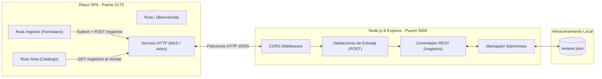

# 📚 BiblioInfo — Plataforma de Reseñas de Libros
> **Componente Práctico Web | Evaluación de Desarrollo Full Stack (React + Node.js/Express + JSON)**  
> **Temática Asignada:** Opción 6 — *Reseñas de libros* (Publicar y consultar reseñas con libro, autor de la reseña, email, fecha, género y contenido de la reseña).

---

## 👥 Datos del Equipo de Desarrollo (4 Integrantes)

| N.° | Integrante | Rol Principal Asignado | Responsabilidad Técnica |
|:---:|:---|:---|:---|
| **1** | `[Nombre y Apellidos Estudiante 1]` | **Frontend Lead** | Arquitectura SPA, React Router, diseño de UI adaptable y estados visuales. |
| **2** | `[Nombre y Apellidos Estudiante 2]` | **Backend Lead** | API REST en Express, endpoints, validación en servidor y persistencia JSON. |
| **3** | `[Nombre y Apellidos Estudiante 3]` | **Integración & HTTP** | Servicios de consumo con Fetch/Axios, manejo de CORS, sincronización de estado. |
| **4** | `[Nombre y Apellidos Estudiante 4]` | **Testing & Documentación** | Pruebas de borde, persistencia tras reinicio, informe PDF, guion y edición del video. |

> ⚠️ **Nota de Coordinación y Exclusividad:**  
> Este proyecto corresponde exclusivamente a la **Opción 6: Reseñas de libros**. Previo al desarrollo se verificó y reservó la exclusividad en la hoja de registro colaborativa del curso para garantizar que ningún otro grupo replique la misma temática ni proceso principal. En el informe final se incluye la captura de pantalla como evidencia.

---

## 📖 1. Contexto y Propósito del Proyecto

**BiblioInfo** es una aplicación web interactiva de extremo a extremo que permite a una comunidad de lectores descubrir, publicar y consultar reseñas literarias. Su objetivo principal es facilitar el intercambio crítico de lecturas mediante una experiencia de usuario fluida, validaciones robustas tanto en cliente como en servidor y almacenamiento persistente en archivos JSON sin necesidad de una base de datos relacional pesada.

### Alcance Funcional:
1. **Bienvenida e Información (`/`):** Portal de inicio con introducción atractiva, métricas de la plataforma, navegación principal y acceso rápido.
2. **Registro de Reseña (`/registro`):** Formulario controlado para crear una nueva reseña con validaciones instantáneas.
3. **Consulta de Reseñas (`/lista`):** Catálogo dinámico de reseñas obtenidas de la API, con filtros por género, estados de carga, manejo de lista vacía y presentación en tarjetas.

---

## 🛠️ 2. Modelo de Datos de la Reseña

Cada reseña registrada en el sistema contiene los siguientes atributos obligatorios:

```json
{
  "id": "e4b2a8d3-52f1-4c28-98e6-7649d6824901",
  "libro": "Cien años de soledad",
  "autorLibro": "Gabriel García Márquez",
  "nombre": "Ana Morales",
  "email": "ana.morales@example.com",
  "genero": "Ficción",
  "fecha": "2026-10-12",
  "calificacion": 5,
  "descripcion": "Una obra maestra del realismo mágico con personajes inolvidables."
}
```

### Reglas de Validación:
- **`libro`**: Obligatorio, mínimo 2 caracteres.
- **`autorLibro`**: Obligatorio, nombre del autor de la obra literaria.
- **`nombre`**: Obligatorio (nombre del autor de la reseña / usuario).
- **`email`**: Obligatorio, formato de correo válido (`usuario@dominio.com`).
- **`genero`**: Obligatorio, selección entre géneros predeterminados (*Ficción, No Ficción, Ciencia Ficción, Misterio, Fantasía, Romance, Desarrollo Personal, Historia*).
- **`fecha`**: Obligatoria, formato `YYYY-MM-DD`, no puede ser una fecha futura.
- **`calificacion`**: Puntuación numérica del 1 al 5.
- **`descripcion`**: Obligatoria, mínimo 15 caracteres para asegurar una reseña sustantiva.

---

## 🏛️ 3. Arquitectura Técnica

El sistema sigue un flujo desacoplado cliente-servidor:



### Tecnologías Utilizadas:
- **Frontend:** React 18+ (con Vite), React Router DOM v6, Vanilla CSS con variables de diseño modernas (Glassmorphism, Dark/Light palettes).
- **Backend:** Node.js, Express, CORS, módulo nativo `fs/promises`, UUID para identificadores únicos.
- **Persistencia:** Archivo JSON local (`data/reviews.json`).
- **Control de Versiones:** Git y GitHub con flujo de ramas y commits colaborativos por los 4 estudiantes.

---

## 📁 4. Estructura del Repositorio

```text
Biblioinfo/
├── README.md                          # Este documento con la guía integral
├── .gitignore                         # Exclusión de node_modules, logs y .env
├── backend/                           # Servidor Node.js + Express
│   ├── data/
│   │   └── reviews.json               # Archivo JSON de almacenamiento persistente
│   ├── src/
│   │   ├── controllers/
│   │   │   └── reviewsController.js   # Lógica de lectura y escritura de reseñas
│   │   ├── routes/
│   │   │   └── reviewsRoutes.js       # Rutas GET /registros y POST /registros
│   │   ├── utils/
│   │   │   └── fileHandler.js         # Lectura/Escritura segura con fs/promises
│   │   └── server.js                  # Inicialización de Express y CORS
│   └── package.json                   # Dependencias y scripts del backend
└── frontend/                          # Cliente React SPA (Vite)
    ├── public/
    ├── src/
    │   ├── assets/                    # Iconos y recursos gráficos
    │   ├── components/                # Componentes reutilizables
    │   │   ├── Navbar.jsx             # Barra de navegación principal
    │   │   ├── ReviewCard.jsx         # Tarjeta para mostrar cada reseña
    │   │   ├── ReviewForm.jsx         # Formulario controlado de registro
    │   │   ├── AlertMessage.jsx       # Notificaciones de éxito/error
    │   │   └── Spinner.jsx            # Indicador de estado de carga
    │   ├── pages/                     # Vistas principales del enrutador
    │   │   ├── Home.jsx               # Ruta '/' (Bienvenida)
    │   │   ├── Register.jsx           # Ruta '/registro' (Formulario)
    │   │   └── ReviewList.jsx         # Ruta '/lista' (Visualización y filtros)
    │   ├── services/
    │   │   └── api.js                 # Métodos fetch/axios centralizados
    │   ├── styles/
    │   │   └── index.css              # Sistema de diseño global responsivo
    │   ├── App.jsx                    # Configuración de React Router
    │   └── main.jsx                   # Punto de entrada de React
    ├── index.html
    └── package.json                   # Dependencias y scripts del frontend
```

---

## 🚀 5. Instrucciones de Instalación y Ejecución

### Prerrequisitos
- Node.js versión **18.x** o superior instalado en el equipo.
- Gestor de paquetes **npm** (incluido con Node.js).
- Git configurado en la terminal.

---

### Paso 1: Clonar el Repositorio
```bash
git clone https://github.com/FranciscoArias10/Biblioinfo.git
cd Biblioinfo
```

---

### Paso 2: Configurar y Levantar el Backend
1. Abrir una terminal y navegar a la carpeta `backend`:
   ```bash
   cd backend
   ```
2. Instalar dependencias:
   ```bash
   npm install
   ```
3. Iniciar el servidor:
   ```bash
   npm run dev
   # o bien: npm start
   ```
4. El servidor estará escuchando en:  
   👉 `http://localhost:5000`  
   *(Verificar endpoint de salud o lista: `http://localhost:5000/registros`)*

---

### Paso 3: Configurar y Levantar el Frontend
1. Abrir **otra terminal diferente** y navegar a la carpeta `frontend`:
   ```bash
   cd frontend
   ```
2. Instalar dependencias:
   ```bash
   npm install
   ```
3. Iniciar el servidor de desarrollo Vite:
   ```bash
   npm run dev
   ```
4. La aplicación estará accesible en el navegador en:  
   👉 `http://localhost:5173`

---

## 📡 6. Documentación de la API REST

| Método | Endpoint | Descripción | Códigos HTTP |
|:---:|:---|:---|:---:|
| `GET` | `/registros` | Obtiene el listado completo de reseñas persistidas | `200 OK`, `500 Internal Error` |
| `POST` | `/registros` | Valida y crea una nueva reseña en `reviews.json` | `201 Created`, `400 Bad Request`, `500 Internal Error` |

### Ejemplo de Petición `POST /registros`
**Headers:** `Content-Type: application/json`  
**Body:**
```json
{
  "libro": "El Principito",
  "autorLibro": "Antoine de Saint-Exupéry",
  "nombre": "Carlos Gómez",
  "email": "carlos.gomez@correo.com",
  "genero": "Ficción",
  "fecha": "2026-10-10",
  "calificacion": 5,
  "descripcion": "Un clásico lleno de reflexiones profundas sobre la vida y la amistad."
}
```

### Respuesta Exitosa (`201 Created`):
```json
{
  "success": true,
  "message": "Reseña registrada con éxito",
  "data": {
    "id": "c1f7a220-4df7-4fa5-9831-4ce88d22d21a",
    "libro": "El Principito",
    "autorLibro": "Antoine de Saint-Exupéry",
    "nombre": "Carlos Gómez",
    "email": "carlos.gomez@correo.com",
    "genero": "Ficción",
    "fecha": "2026-10-10",
    "calificacion": 5,
    "descripcion": "Un clásico lleno de reflexiones profundas sobre la vida y la amistad."
  }
}
```

### Respuesta con Datos Inválidos (`400 Bad Request`):
```json
{
  "success": false,
  "message": "Errores de validación en la solicitud",
  "errors": [
    "El formato de correo electrónico es inválido",
    "La descripción debe contener al menos 15 caracteres"
  ]
}
```

---

## 🎬 7. Planificación y Estructura del Video Grupal (20 Puntos)

**Duración estipulada:** Entre 20 y 30 minutos.  
**Requisito clave:** Participación activa y sustancial de los 4 integrantes en pantalla, mostrando código, terminal, pruebas y decisiones de arquitectura.

| N.° | Etapa del Video | Minutos Sugeridos | Responsable | Contenido a Demostrar en Grabación |
|:---:|:---|:---:|:---|:---|
| **1** | **Presentación** | 00:00 - 03:00 | *Todos los integrantes* | • Presentación de los 4 estudiantes.<br>• Explicación de la temática exclusiva (Reseñas de libros).<br>• Planteamiento del problema y solución de BiblioInfo.<br>• Muestra de la tabla de distribución de actividades. |
| **2** | **Preparación del Entorno** | 03:00 - 06:00 | *Estudiante 4* | • Estructura de carpetas (`frontend/` y `backend/`).<br>• Explicación de `package.json`, librerías y `.gitignore`.<br>• Ejecución de comandos para iniciar backend y frontend en dos terminales. |
| **3** | **Construcción del Frontend** | 06:00 - 11:00 | *Estudiante 1* | • Enrutador con `react-router-dom` (`/`, `/registro`, `/lista`).<br>• Componentes reutilizables (`ReviewForm`, `ReviewCard`, `Navbar`).<br>• Estado de React (`useState`, campos controlados).<br>• Validaciones en el cliente (email regex, fecha, requeridos) y mensajes visuales. |
| **4** | **Construcción del Backend** | 11:00 - 16:00 | *Estudiante 2* | • Servidor Express, middleware `express.json()` y CORS.<br>• Rutas `GET /registros` y `POST /registros`.<br>• Lógica de validación en el servidor con códigos `400` y `201`.<br>• Asignación de ID único (`crypto.randomUUID()`).<br>• Lectura y escritura asíncrona segura en `reviews.json` (`fs/promises`). |
| **5** | **Integración Frontend ↔ Backend** | 16:00 - 20:00 | *Estudiante 3* | • Servicio de conexión HTTP con `fetch`/`axios`.<br>• Configuración de la URL base del backend (`http://localhost:5000`).<br>• Envío del formulario con POST y obtención con GET.<br>• Actualización dinámica del estado y redirección a la lista. |
| **6** | **Batería de Pruebas en Vivo** | 20:00 - 26:00 | *Todos los integrantes* | • **Prueba 1 (Éxito):** Registro de reseña válida y visualización inmediata en `/lista`.<br>• **Prueba 2 (Validación Cliente):** Intento con email inválido o campos vacíos.<br>• **Prueba 3 (Validación Servidor):** Petición defectuosa por Postman/ThunderClient recibiendo `400 Bad Request`.<br>• **Prueba 4 (Manejo de Estados):** Visualización de estado de carga y lista vacía.<br>• **Prueba 5 (Persistencia):** Reinicio total del servidor backend (`Ctrl+C` y reinicio) y recarga del frontend demostrando que los datos no se pierden. |
| **7** | **Cierre y Conclusiones** | 26:00 - 30:00 | *Todos los integrantes* | • Resumen de logros y valor aportado por cada integrante.<br>• Retos técnicos encontrados (ej. manejo de CORS, concurrencia en JSON) y cómo se resolvieron.<br>• Muestra del repositorio Git con commits identificables de los 4 miembros. |

---

## 🎯 8. Guía de Preparación para la Pregunta Técnica Individual (10 Puntos)

Cada estudiante debe dominar el funcionamiento integral de la solución para responder la pregunta técnica del docente en la sustentación:

1. **¿Cómo se asegura la persistencia sin base de datos?**
   > *Respuesta clave:* Mediante el módulo `fs/promises` de Node.js. Al recibir un `POST`, se lee el archivo `reviews.json`, se parsea a un array de JavaScript con `JSON.parse()`, se agrega el nuevo objeto validado con su UUID, y se sobreescribe el archivo con `JSON.stringify(data, null, 2)` usando `fs.writeFile()`. Si el archivo no existe, se inicializa automáticamente como `[]`.

2. **¿Por qué se validan los datos en ambos lados (Frontend y Backend)?**
   > *Respuesta clave:* La validación en el frontend mejora la experiencia de usuario (UX) ofreciendo retroalimentación inmediata sin recargar ni hacer peticiones innecesarias. La validación en el backend es fundamental por seguridad e integridad de datos, ya que un cliente malicioso o una herramienta como Postman podría enviar datos directamente a la API saltándose el frontend.

3. **¿Qué es CORS y por qué se configuró en el backend?**
   > *Respuesta clave:* CORS (*Cross-Origin Resource Sharing*) es una política de seguridad del navegador que bloquea peticiones HTTP entre diferentes orígenes (distinto dominio o puerto). Como el frontend corre en el puerto `5173` y el backend en el `5000`, fue necesario habilitar el middleware `cors()` en Express para permitir que React consuma los recursos del servidor sin bloqueos de seguridad.

4. **¿Cómo gestiona React el ciclo de vida y la obtención de datos en `/lista`?**
   > *Respuesta clave:* Se utiliza el hook `useEffect` con un array de dependencias vacío `[]` para ejecutar la petición `GET /registros` una única vez cuando el componente se monta en el DOM. Durante la petición se activa un estado `loading = true`, y al recibir la respuesta se actualiza el estado `reviews` con `setReviews(data)` y se desactiva el loading.

5. **¿Por qué se utiliza UUID para los identificadores en lugar de un contador numérico?**
   > *Respuesta clave:* UUID (`crypto.randomUUID()`) garantiza identificadores universalmente únicos y aleatorios, evitando colisiones accidentales y eliminando la necesidad de calcular o buscar el último ID numérico secuencial en el archivo JSON.

---

## 📋 9. Lista de Verificación para la Entrega Final

- [ ] Temática exclusiva comprobada en la hoja compartida del curso (sin coincidencias).
- [ ] Backend con rutas `GET /registros` y `POST /registros` operando con archivo JSON.
- [ ] Frontend React SPA con rutas `/`, `/registro` y `/lista` funcionando con React Router.
- [ ] Validaciones completas en cliente y servidor funcionando con feedback visual.
- [ ] Persistencia verificada tras apagar y reiniciar el servidor Node.js.
- [ ] Repositorio en GitHub con carpetas `frontend/` y `backend/`, sin `node_modules` y con historial de commits de los 4 integrantes.
- [ ] Grabación del video (20-30 minutos) cubriendo las 7 etapas con la participación de todos.
- [ ] Informe en PDF preparado (`Componente_Practico_Web_BiblioInfo.pdf`) con portada, captura del registro, arquitectura, capturas de pantalla, enlaces al repositorio y al video.
